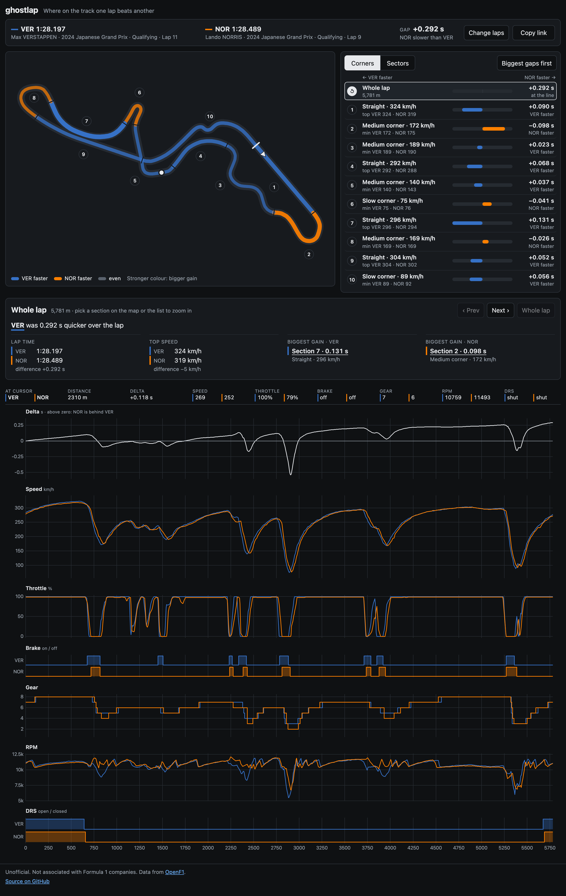

# ghostlap

Pick any two Formula 1 laps from 2023 onward and see them overlaid by distance: speed, throttle, brake, gear, RPM, DRS and a running time delta. Every comparison is a link.

Underneath is a time-series storage engine written in Go for this one kind of data: column-oriented, compressed, CRC-protected segment files, an mmap reader, a concurrent HTTP API, and a write-ahead log for live sessions.

> Unofficial. Not associated with Formula 1 companies. Data from [OpenF1](https://openf1.org).



## Status

| Milestone | State |
|---|---|
| M0 data spike | Done. Findings in [docs/DATA.md](docs/DATA.md). |
| M1 ingest + storage engine | Done. Full-corpus ingest takes about 12 hours at OpenF1's rate limit; see [docs/BENCHMARKS.md](docs/BENCHMARKS.md) for how much was ingested when the numbers were taken. |
| M2 query API | Done. [docs/API.md](docs/API.md). |
| M3 web UI | Done. Tested in Chromium (desktop and phone viewports); Safari and Firefox not yet checked. |
| M4 launch | Image, CI and deploy guide done ([docs/DEPLOY.md](docs/DEPLOY.md)). **Not deployed**: needs a VPS and a Cloudflare account. |
| M5 live ingest | WAL, memtable, seal and crash test done, driven by replaying recorded sessions. No live network client: OpenF1's live feed is paid. |

## Numbers

All from `bench/report.sh`, which regenerates [docs/BENCHMARKS.md](docs/BENCHMARKS.md). Taken on a development laptop, not the target VPS.

<!-- numbers:start -->
<!-- numbers:end -->

## How it works

```
                 ┌───────────────────────────── cmd/ingest ─────────────────────────────┐
OpenF1 API ──►   │ rate limiter ─► fetch workers ─► raw cache ─► clean ─► lap slicer ─►  │
                 │                                                    segment writer    │
                 └──────────────────────────────────────────────────────────┬──────────┘
                                                                            ▼
                                             data/segments/{session}-{hash}.seg  (immutable)
                                             data/MANIFEST                       (atomic rename)
                                                                            │ mmap
                 ┌───────────────────────────── cmd/server ─────────────────▼──────────┐
browser ──────►  │ HTTP API ─► response cache ─► lap cache (LRU) ─► segment reader      │
 (Vite/uPlot)    │  /metrics                     align + resample by distance           │
                 └──────────────────────────────────────────────────────────────────────┘

live:  events ─► WAL (append, fsync) ─► memtable ─► in-memory segment for queries ─► sealed segment
```

- **Segment file** ([docs/FORMAT.md](docs/FORMAT.md)): one per session. One block per (driver, lap, channel), each with its own CRC32, then a sorted index and lap table, then a footer. Reading one lap touches only that lap's blocks. A damaged block fails that lap and nothing else.
- **Encodings**: delta or delta-of-delta with zigzag varints for smooth channels (the writer keeps whichever is smaller per block), run-length for gear and DRS, boolean run-length for brake, and a validity bitmap for missing readings.
- **Laps**: telemetry is cut at the official lap boundaries. Distance is integrated from speed and scaled so that each timed lap reaches the circuit length exactly at its official lap time. Two laps are compared on a common distance grid; the final delta therefore equals the official lap-time difference.
- **Store**: the set of open segments is an immutable snapshot behind an atomic pointer, with reference-counted mappings, so a rebuilt session is swapped in without a restart and without a lock on the read path. Decoded laps sit in a sharded, byte-bounded LRU; concurrent requests for the same lap decode it once.
- **Live path**: events go to a write-ahead log (length-prefixed records with CRC, group commit) and a memtable. Queries see an in-memory segment rebuilt about once a second. When the session ends it is sealed into a normal segment by the same code batch ingest uses.

## Run it

```bash
go run ./cmd/ingest -year 2024 -session 9492      # one session (2024 Japan qualifying), about 90 s
cd web && npm ci && npm run build && cd ..
go run ./cmd/server                                # http://localhost:8080/?a=9492:1:fastest&b=9492:4:fastest
```

`go run ./cmd/ingest -year all` fetches everything. It caches every raw response, stays under OpenF1's limit of 30 requests per minute, and resumes where it stopped.

Other tools:

```bash
go run ./cmd/segdump -driver 1 data/segments/9492-*.seg   # header, per-channel sizes, lap table
go run ./cmd/bench                                        # compression, decode speed, lookup latency
go run ./cmd/replay -year 2024 -session 9492 -speed 10    # a recorded session through the live path
bench/report.sh                                           # regenerate docs/BENCHMARKS.md
```

## Tests

```bash
go test -race ./...                                  # unit, property, integration, crash test
go test ./internal/encoding -fuzz FuzzDecodeBlock    # one of eight fuzz targets
go test ./internal/ingest -run Golden -v             # against official timing; needs ingested sessions
cd web && npm test                                   # Playwright smoke tests
```

The golden tests need real data and skip without it; the list of sessions and the command to ingest them is at the top of `internal/ingest/golden_test.go`.

## Layout

```
cmd/ingest      discover + fetch + build segments     internal/openf1    API client, rate limit, raw cache
cmd/server      HTTP API + static files               internal/laps      slicing, distance, alignment
cmd/bench       storage benchmarks                    internal/encoding  codecs (+ fuzz tests)
cmd/segdump     inspect a segment                     internal/segment   file format, mmap reader
cmd/replay      recorded session through live path    internal/store     manifest, registry, lap cache
cmd/spike       milestone-0 data probe                internal/lru       sharded byte-bounded LRU
web/            Vite + TypeScript + uPlot             internal/wal       write-ahead log
bench/          load test + report scripts            internal/live      memtable, replay, seal
docs/           PRD, DATA, FORMAT, API, DEPLOY        internal/api       HTTP handlers, metrics
```

## Known limits

- Telemetry is about 3.7 Hz with integer km/h, and the feed's lap start times are good to a few tens of milliseconds. The delta is exact at the end of the lap and approximate in between.
- Circuit length is measured from the data (median integrated distance of clean laps) and comes out about 0.5% short of the official figure.
- Only samples inside a lap are stored; time in the garage is dropped.
- Free, non-commercial, no ads, no accounts, no third-party scripts.
